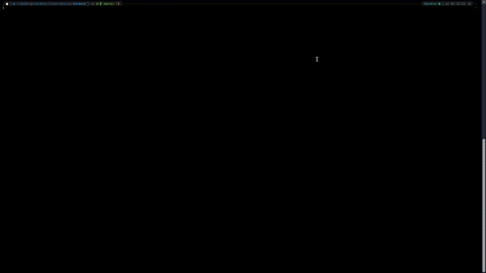
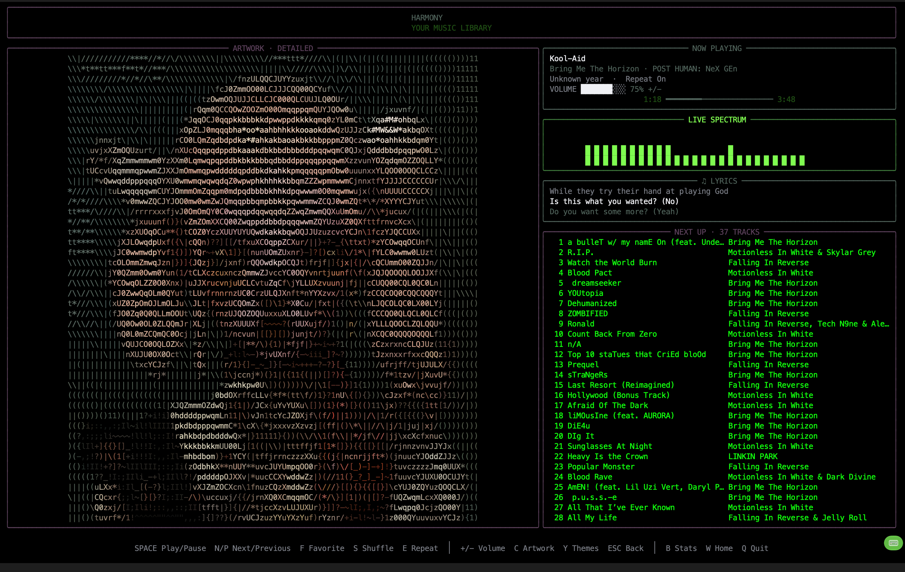
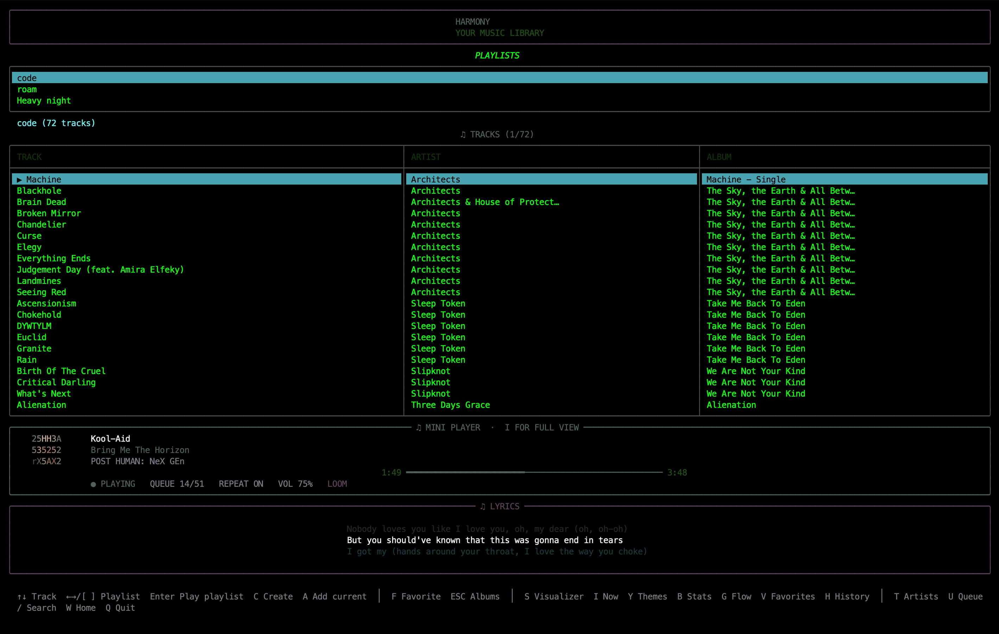
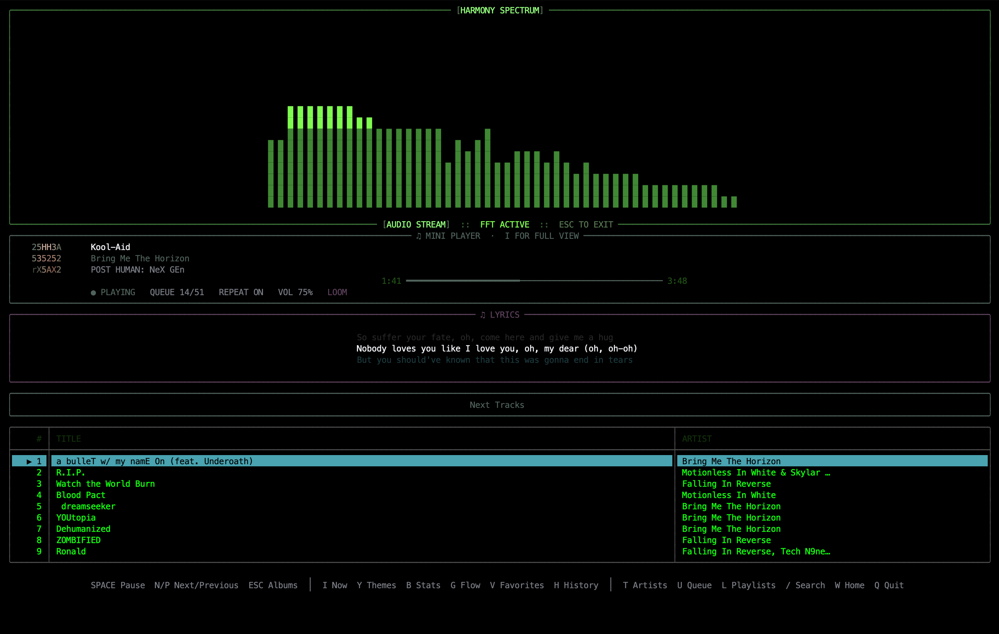
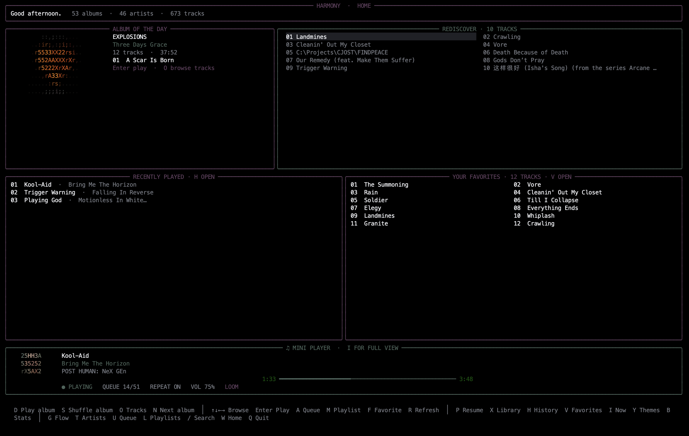
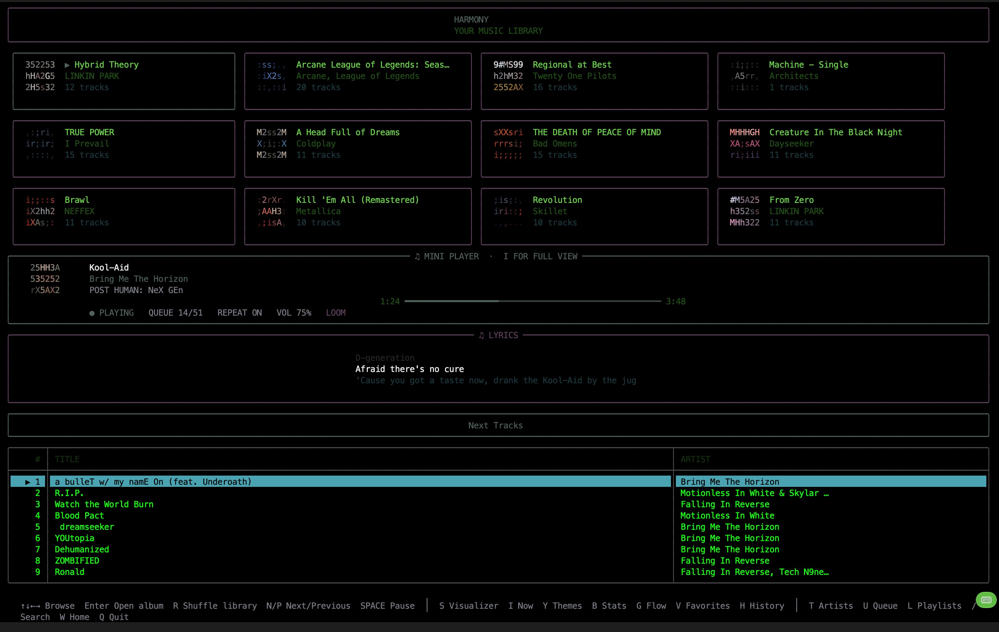

# Harmony
<p align="center">
  
</p>

## A  macosx keyboard-driven terminal music player for your personal music library.

Harmony is a local-first music library manager and terminal music player built with Python. It scans MP3 collections, organizes music metadata, retrieves synchronized lyrics, and provides an interactive listening experience directly in the terminal.

Featuring album artwork, listening statistics, persistent playlists, and intelligent shuffle modes, Harmony aims to bring a complete music player experience to the command line.

The main player is built with Python, Rich, and mpv.

Project status: Actively developed personal project.

The primary player uses Python, [Rich](https://github.com/Textualize/rich), and
[mpv](https://mpv.io/). 

> **Project status:** Harmony is an actively evolving personal project. Some
> features are experimental.

## Contents

- [Features](#features)
- [Requirements](#requirements)
- [Install](#install)
- [Get started](#get-started)
- [Music library and scanning](#music-library-and-scanning)
- [Controls](#controls)
- [Harmony Flow](#harmony-flow)
- [Data and privacy](#data-and-privacy)
- [Run tests](#run-tests)
- [Project layout](#project-layout)
- [License](#license)

## Features

- Incremental MP3 library scanning with ID3 metadata, album art, and cached scan
  results.
- Optional synchronized lyric lookup through LRCLIB. Temporary network errors
  can be retried on a later scan.
- Responsive terminal screens for Home, albums, tracks, artists, search,
  playlists, favorites, listening history, queue, and statistics.
- ASCII-rendered album artwork, selectable color themes, and a live audio
  spectrum visualizer.
- Persistent favorites, playlists, listening history, listening statistics,
  settings, and playback queue.
- Harmony Flow queue modes: Classic Shuffle, Smart Shuffle, Discovery, and
  Favorites Mix.
- Volume, repeat, previous/next, and resume controls.

## Requirements

- Python 3.10 or newer.
- `mpv` installed and available on `PATH`.
- macOS is the primary target for the main terminal player. It uses macOS
  Touch ID before startup and integrates with macOS media controls.


## Install

Clone the repository and enter its root directory:

```bash
git clone <repository-url>
cd Harmony
```

Create and activate a virtual environment, then install the Python
dependencies:

```bash
python3 -m venv .venv
source .venv/bin/activate
python -m pip install --upgrade pip
python -m pip install -r requirements.txt
```

Install mpv with your system package manager. On macOS with Homebrew:

```bash
brew install mpv
```

Check that both tools are available:

```bash
python --version
mpv --version
```

## Get started

From the repository root, start the interactive launcher:

```bash
python -m app.launcher
```

The launcher offers:

1. **Scan music library** — scan the configured library folder and update the
   JSON and SQLite catalogs.
2. **Launch Harmony player** — open the terminal player.
3. **Exit**.

You can also run the scanner or player directly:

```bash
python -m app.tools.scannerv2
python -m app.src.Harmony
```

The player asks for Touch ID on macOS before starting. It requires a generated
`library.json`; scan your music first if you do not already have one.

## Music library and scanning

The scanner recursively searches for .mp3 files. It groups tracks by the folder containing them, reads available ID3 tags, looks for local or embedded cover art, and can look up synchronized lyrics online. Keep tracks from the same album together in a single folder for the expected album grouping.

### Music library location

Harmony uses ~/.harmony/.play/ as its default music library directory.

The expected directory structure is:

```text
~/.harmony/
├── harmony.sqlite3
└── .play/
    ├── library.json
    ├── Album 1/
    │   ├── track01.mp3
    │   └── track02.mp3
    └── Album 2/
        └── track01.mp3
```

The scanner uses the directory containing library.json as its scan root. By default, this is ~/.harmony/.play/.

The library location can be overridden using the HARMONY_LIBRARY_PATH environment variable. This variable can point either to a library directory or directly to a library.json file.

If the directory or library file does not exist, Harmony can create the required directory and initialize the library when needed.

To scan your music, choose Scan music library in the launcher or run the scanner command directly.

The scanner updates library.json and synchronizes its catalog to SQLite while preserving player data such as favorites and playback history.

There is no scan-root command-line option yet. The default library location and its configuration are defined in app/scripts/library_config.py.

### Incremental scanning

The scanner is incremental: it reuses cached metadata and successful lyric lookups for unchanged tracks, processes new or modified files, and removes missing tracks from the generated catalog.

Network-dependent lyric lookups require an internet connection. The local player can still play previously scanned tracks offline.

## Controls

Harmony is keyboard-driven. The footer on each screen lists its current
shortcuts. Common controls include:

| Key | Action |
| --- | --- |
| `W` | Return Home |
| `↑` / `↓` | Select or browse items |
| `←` / `→` | Browse horizontally where available |
| `Enter` | Open or play the selected item |
| `Space` | Pause or resume |
| `N` / `P` | Next / previous track |
| `H` / `V` | Listening history / favorites |
| `L` | Playlists |
| `/` | Search |
| `C` | Create a playlist |
| `B` | Listening statistics |
| `G` | Harmony Flow |
| `I` | Now Playing |
| `Y` | Themes |
| `Q` | Quit |

Home offers additional actions for the daily album and Rediscover tracks. Key
bindings vary by screen; for example, `D` plays the daily album on Home and
toggles dynamic artwork colors in Themes.

## Harmony Flow

Harmony Flow builds a queue from tracks whose files are available:

- **Classic Shuffle** randomizes the available tracks.
- **Smart Shuffle** spreads artists and albums and cools down recently played
  tracks.
- **Discovery** favors tracks that are missing from recent listening history.
- **Favorites Mix** blends favorite tracks with less recently heard tracks.

Tracks already queued stay ahead of the generated tracks.

## Data and privacy

Harmony stores its SQLite database at:

```text
~/.harmony/harmony.sqlite3
```

This database contains the scanned catalog and local player data, including
favorites, playlists, recent history, playback queue, listening statistics,
themes, and other settings. The directory is created automatically. If the
database is not found there but the older repository-local
`.play/harmony.sqlite3` exists, Harmony copies it to the new location on first
use and leaves the original in place.

The library catalog is also written to `library.json` so existing clients can
continue to use it. On first startup, Harmony can import the legacy
`.play/player_state.json` state file; that JSON file is retained as a backup.
The scanner may contact LRCLIB to find lyrics for tracks that need them.

## Run tests

Run the unit tests from the repository root:

```bash
python -B -m unittest discover -s app/tests -v
```

## Project layout

```text
app/
├── core/       # Navigation and event coordination
├── data/       # SQLite database and persistence
├── features/   # Home, artwork, themes, statistics, and shuffle logic
├── scripts/    # Rich UI, mpv integration, playlists, and helpers
├── src/        # Main terminal player
├── tests/      # Unit and integration tests
└── tools/      # Library scanner
```

## Demo 





## License
This project is licensed under the MIT License.
See the [LICENSE](LICENSE) file for details.
